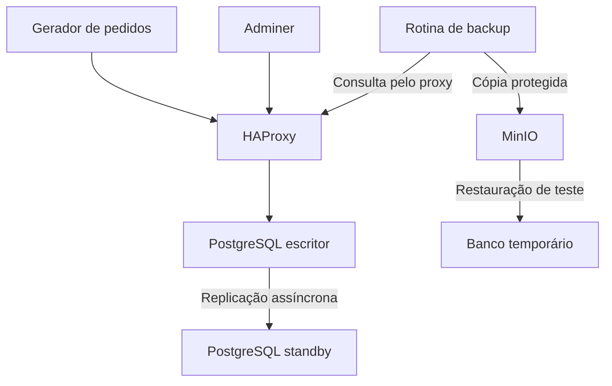

# Lab de recuperação — guia para apresentar sem se perder

**Módulo 9.1 · Loja Potengi · PostgreSQL, HAProxy e MinIO**  
Guia do ZIP corrigido a partir de `modulo-9-1-dr-lab-correcao-main(1).zip`, com as evidências recebidas em 22/10/2026.

**Para apresentar ao vivo:** prepare as abas da seção 5 e siga as tabelas da seção 6. Cada linha mostra o comando, o efeito e onde conferir. **Os ajustes dos incidentes já estão aplicados neste ZIP. Ensaie o fluxo antes da aula.**

> **A ideia da apresentação:** provocar uma falha controlada, mostrar o efeito, recuperar o serviço e comprovar o resultado. O laboratório mantém o `./lab.sh` como entrada principal. As correções acrescentam controle sobre quem pode escrever, recuperação da réplica e backup remoto testável.

## Índice

1. [Resumo para abrir a apresentação](#1-resumo-para-abrir-a-apresentação)
2. [Como o ambiente funciona](#2-como-o-ambiente-funciona)
3. [Os três gaps priorizados](#3-os-três-gaps-priorizados)
4. [Preparação antes da aula](#4-preparação-antes-da-aula)
5. [Abra estas telas antes de começar](#5-abra-estas-telas-antes-de-começar)
6. [Fluxo ao vivo: comando → mudança → tela → recuperação](#6-fluxo-ao-vivo-comando--mudança--tela--recuperação)
7. [RTO, RPO e MTTR sem confundir as medidas](#7-rto-rpo-e-mttr-sem-confundir-as-medidas)
8. [Resultados já observados](#8-resultados-já-observados)
9. [Roteiro de fala e entregas D1, D2 e D3](#9-roteiro-de-fala-e-entregas-d1-d2-e-d3)
10. [Perguntas que podem aparecer](#10-perguntas-que-podem-aparecer)
11. [O que foi aplicado neste ZIP](#11-o-que-foi-aplicado-neste-zip)

---

## 1. Resumo para abrir a apresentação

> “Nosso laboratório simula pedidos de uma loja. O gerador grava pelo HAProxy, que encaminha a conexão para o PostgreSQL autorizado a escrever. Um segundo PostgreSQL recebe a replicação. Os backups são enviados ao MinIO e podem ser restaurados em um banco temporário. Priorizamos três riscos: dois bancos aceitarem escrita após uma falha, o proxy encaminhar escrita para uma réplica ainda não promovida e a ausência de uma cópia remota protegida e testada.”

**Metas do exercício:** RTO de até **30 minutos** e RPO de até **5 minutos**. São metas; o resultado depende da medição em cada execução.

**Não confundir:** os **três gaps corrigidos** são problemas da arquitetura. Os **incidentes 1, 2 e 3** são exercícios para avaliar o ambiente. Não existe correspondência obrigatória de um gap para cada incidente.

## 2. Como o ambiente funciona



| Componente | Papel no laboratório |
|---|---|
| `pg-primary` e `pg-replica` | Dois nós PostgreSQL. Inicialmente, o primeiro escreve e o segundo é standby. |
| `haproxy` | Endereço único do banco para clientes; só encaminha para o escritor autorizado e apto a escrever. |
| `gerador` | Insere um pedido aproximadamente a cada 5 segundos. Mostra `ESCRITA FALHOU` quando a operação falha. |
| `app` | Adminer: interface web para consultar o banco. Não é uma loja virtual completa. |
| `backup` | Gera dumps, envia ao MinIO e registra o último conjunto concluído. |
| `minio` | Armazena objetos de backup com versionamento e retenção COMPLIANCE de 7 dias. |
| `minio-test` | Inicializa/verifica a proteção; termina após o teste. |
| `archive-init` | Prepara o volume de WAL; também termina após executar. |
| `kuma` | Interface de monitoramento. Os monitores precisam estar configurados para produzir evidências. |
| `restore-db` | Banco temporário criado por `testar-backup` e removido ao final. |

**O nome do contêiner não determina seu papel atual.** Após o failover, `pg-replica` pode ser o escritor e `pg-primary` pode voltar como standby.

```bash
cat runtime/active
```

Esse arquivo registra o escritor autorizado. A consulta SQL confirma o papel real:

- `pg_is_in_recovery() = f`: nó fora de recovery; pode exercer o papel de escritor.
- `pg_is_in_recovery() = t`: standby em recovery.

O controle combina autorização, bloqueio do nó antigo e consultas ao banco. O arquivo sozinho não prova que o serviço está saudável.

## 3. Os três gaps priorizados

| Prioridade e gap | Risco | Correção implementada | Como demonstrar |
|---|---|---|---|
| **P0 — retorno inseguro do antigo primário** | Após a promoção, o nó antigo voltar com dados divergentes e aceitar escrita, causando split-brain. | Escritor autorizado persistente, bloqueio do nó antigo e reintegração por novo clone. | Após o failover, mostrar o escritor atual; reintegrar o antigo e confirmar que voltou como standby. |
| **P0 — proxy sem verificar o papel do banco** | Porta aberta ser interpretada como banco pronto para escrita, encaminhando operações a um standby. | HAProxy verifica autorização e condição de escrita. O failover isola o antigo nó antes de promover o candidato. | Durante a falha, a escrita fica indisponível; após a promoção controlada, volta pelo mesmo proxy. |
| **P1 — backup sem recuperação remota comprovada** | Perder a cópia local e não conseguir restaurar; intervalo original de 15 minutos exceder a meta de 5 minutos. | Upload real ao MinIO, versões, retenção, SHA-256 e restore isolado. Rotina aguarda 60 segundos entre ciclos. | Mostrar `MINIO_LOCK_OK`, `BACKUP_RECENTE` e `RESTORE_OK`, com o conjunto restaurado. |

### Quais arquivos materializam essas correções?

| Arquivo ou grupo | O que mudou |
|---|---|
| `lab.sh` | Preserva os comandos básicos e acrescenta `failover`, `reintegrar`, `backup`, `testar-backup`, `validar`, `status`, `logs` e `construir`. |
| `docker-compose.yml` | Liga os scripts aos serviços, acrescenta verificações e o banco de restauração temporário. |
| `haproxy/haproxy.cfg`, `scripts/check-writer.sh`, `scripts/start-haproxy.sh` | Encaminhamento condicionado ao escritor autorizado e ao estado SQL. |
| `scripts/start-db.sh`, `scripts/failover.sh`, `scripts/rejoin.sh` | Bloqueio de retorno inseguro, promoção controlada e reintegração. |
| `backup/backup.py`, `scripts/backup-now.sh`, `scripts/restore-test.sh` | Backup remoto, verificação dos objetos e teste de recuperação. |
| `scripts/check.sh` | Confere papéis, streaming, escrita pelo proxy e idade do backup. |
| `scripts/archive-wal.sh` | Publica arquivos WAL de forma atômica no volume de archive. |

**Limites que continuam existindo:** replicação assíncrona pode perder transações; failover exige ação do operador; todos os serviços estão no mesmo host; não há PITR completo implementado. A proteção de objetos não protege contra perda física do host/volume. Alertas, capacidade de disco e retenção de WAL ainda exigem trabalho.

## 4. Preparação antes da aula

### Qual pasta usar nesse ZIP?

Entre em `modulo-9-1-dr-lab-correcao-main/lab/`, onde estão o Compose corrigido e o `lab.sh`.
A cópia antiga `lab/lab/` foi removida: não havia arquivos exclusivos nela.

**Ao atualizar seu projeto existente:** copie o conteúdo desta `lab/` para a pasta que você já usa. Preserve `runtime/` e `evidencias/` locais. Não inicialize uma pasta de controle vazia sobre volumes que já passaram por failover. A remoção da cópia de código antiga não exige excluir volumes Docker.

Os incidentes agora usam o layout corrigido:

- O incidente 2 remove os dumps de `/backups/complete/`, mantendo o MinIO.
- `incidente reverter 1 --descartar-dados-do-no` reintegra o antigo primário após promoção. Sem promoção, `incidente reverter 1` pode religar o escritor original.
- O incidente 3 recusa parar `pg-replica` se os papéis já estiverem invertidos. A reversão aguarda streaming.

### Preparação única

Se alterou a imagem ou `backup.py`, rode `./lab.sh construir` antes da aula. Se houver erro de permissão, ajuste `chmod +x lab.sh incidentes/*.sh`.

| Execute, um comando por vez | O que acontece | O que conferir |
|---|---|---|
| `./lab.sh subir` | Inicia a stack e prepara o controle do escritor. | Aguarde cerca de 30 segundos. `Started` ainda não comprova saúde. |
| `./lab.sh status` | Lista os serviços. | Bancos e serviços contínuos em execução; `archive-init` e `minio-test` podem ficar **Exited (0)**. |
| `cat runtime/active` | Mostra o escritor autorizado. | Para o início deste roteiro, deve ser `pg-primary`. |
| `./lab.sh validar` | Testa escrita, streaming e idade do backup. | Deve terminar com `CHECAGEM OK`. |
| `./lab.sh testar-backup` | Restaura a cópia remota em banco temporário. | Deve mostrar `RESTORE_OK`; a remoção de `restore-db` ao final é normal. |

`./lab.sh checar` agora executa a mesma validação de `validar` e salva sua saída em `evidencias/checagem_*.txt`. Ambos reconhecem os papéis atuais e retornam erro quando a validação falha.

Se alguma pré-condição falhar, consulte os logs antes de provocar incidentes. Não apague `runtime/` para forçar o nome do escritor.

## 5. Abra estas telas antes de começar

| Aba | Endereço e acesso | Deixe preparado |
|---|---|---|
| **1 — aplicação/banco pelo proxy** | http://localhost:8080 — PostgreSQL; servidor `haproxy`; usuário `postgres`; senha `lab91pass`; banco `loja`. | Abra a opção de executar SQL e use a consulta abaixo. |
| **2 — HAProxy** | http://localhost:8404/ | Localize `postgres_pool` e as linhas `pg-primary` e `pg-replica`. |
| **3 — backups remotos** | http://localhost:9001 — usuário `labadmin`; senha `lab91minio`. | Abra o bucket `backups`, prefixo `sets/` e um conjunto de backup. |
| **4 — réplica diretamente** | Abra http://localhost:8080 em janela privada; use os mesmos dados, mas servidor **`pg-replica`**. | Execute `SELECT pg_is_in_recovery();`: antes dos incidentes, deve retornar `t`. |
| **5 — monitoramento, opcional** | http://localhost:3001 | Use somente monitores que a equipe já configurou e testou. |

**Consulta para manter na aba 1:**

```sql
SELECT count(*) AS pedidos, max(criado) AS ultimo_pedido FROM pedidos;
```

Execute, espere cerca de 5–10 segundos e execute novamente. O total deve aumentar. **O resultado SQL não se atualiza sozinho:** é preciso executar outra vez.

Para mostrar pedidos individuais:

```sql
SELECT id, cliente, valor, criado FROM pedidos ORDER BY id DESC LIMIT 10;
```

### Como interpretar as telas

- **Adminer:** a página web pode continuar abrindo enquanto o banco está indisponível. A prova é conseguir consultar/gravar, não ver a tela de login.
- **HAProxy:** mostra elegibilidade para receber tráfego. O standby pode aparecer como `MAINT`/desabilitado mesmo estando saudável. Não use essa linha isolada para provar queda da réplica.
- **MinIO:** exibe a cópia remota. Apagar um dump local não deve fazê-lo desaparecer dessa tela.
- **Kuma:** não vem com os monitores automaticamente configurados por esses scripts. Se quiser usá-lo, prepare monitores TCP separados para `pg-primary:5432` e `pg-replica:5432`, usando os nomes internos dos serviços. Eles mostram disponibilidade da porta, não comprovam papel de escritor nem sucesso de uma transação. Aguarde o intervalo configurado para observar uma mudança.

Os endereços `localhost` são para o computador que executa o lab. As portas do Compose estão vinculadas a `127.0.0.1`.

## 6. Fluxo ao vivo: comando → mudança → tela → recuperação

**Não cole todos os comandos de uma vez.** Execute uma linha, mostre o efeito e só então avance. A ordem sugerida é **3 → 2 → 1**, para deixar a troca de escritor por último. Se a atividade exigir 1 → 2 → 3, use o retorno planejado descrito no final desta seção.

### Primeiro: mostre o ambiente funcionando

| Comando/ação | O que mudou ou foi comprovado | Onde olhar | O que dizer |
|---|---|---|---|
| `./lab.sh validar` | Escrita pelo proxy, standby em streaming e backup recente passaram no teste. | Terminal: `CHECAGEM OK`. | “Este é nosso ponto de partida saudável.” |
| Execute a consulta de pedidos duas vezes. | Novos pedidos foram gravados entre as consultas. | **Aba 1 — Adminer, :8080.** | “O gerador está alimentando o banco pelo proxy.” |
| Atualize a página do HAProxy. | Mostra qual backend está apto a receber escrita. | **Aba 2 — :8404.** | “O tráfego vai para o escritor autorizado.” |

### Incidente 3 — a réplica caiu, mas a aplicação continua

**Antes:** `pg-primary` escritor; `pg-replica` standby. **Objetivo:** mostrar perda e recuperação de redundância.

| Etapa e comando | O que muda | Onde olhar e resultado esperado |
|---|---|---|
| **1.** `./lab.sh incidente iniciar 3` | Para `pg-replica` e registra o início. | **Aba 4 — Adminer conectado diretamente a pg-replica:** execute novamente a consulta; ela deve falhar. A página web em si continua acessível. |
| **2.** Execute novamente a consulta de pedidos. | O escritor segue atendendo. | **Aba 1 — Adminer via haproxy:** o total continua aumentando. |
| **3.** `./lab.sh validar` | Detecta ausência de standby. | **Terminal:** erro de redundância. É esperado durante a falha. No Kuma, o monitor da réplica deve cair após o intervalo configurado, se existir. |
| **4.** `./lab.sh incidente marcar 3 "Redundância ausente; aplicação segue gravando"` | Registra a detecção. | **Terminal/log:** nova marca com horário. Nenhuma tela web precisa mudar. |
| **5.** `./lab.sh incidente reverter 3` | Religa `pg-replica`. | **Aba 4:** após recuperar a conexão, `pg_is_in_recovery()` volta a retornar `t`. Isso sozinho ainda não comprova streaming. |
| **6.** `./lab.sh validar` | Confirma streaming e demais condições. | **Terminal:** `CHECAGEM OK`. Se ainda falhar, aguarde a inicialização e investigue os logs se persistir. |
| **7.** `./lab.sh incidente recuperado 3` | Registra o fim e calcula a duração da rodada. | **Terminal:** `MTTR=...`. Aqui representa o tempo para recuperar redundância; a aplicação não ficou necessariamente indisponível. |

**Fala de fechamento:** “A loja continuou gravando, mas estava sem redundância. Conseguimos detectar e recuperar essa condição.”

### Incidente 2 — o backup local sumiu, a cópia remota ficou

**Antes:** ensaie este fluxo. Os scripts do incidente 2 já estão corrigidos neste ZIP. Gere um backup e aprove uma restauração remota antes de remover os dumps locais.

| Etapa e comando | O que muda | Onde olhar e resultado esperado |
|---|---|---|
| **1.** `./lab.sh backup` | Gera e envia um novo conjunto completo. | **Aba 3 — MinIO, :9001:** atualize `backups/sets/`; deve aparecer um conjunto novo. |
| **2.** `./lab.sh testar-backup` | Confirma que existe uma cópia remota recuperável antes da perda. | **Terminal:** `RESTORE_OK`. Só avance se passar. |
| **3.** `./lab.sh incidente iniciar 2` | Para a rotina e remove os dumps locais concluídos. | **Terminal:** confirmação da remoção. **Aba 3:** os objetos remotos continuam lá. **Aba 1:** pedidos continuam sendo gravados. |
| **4.** Execute a consulta de arquivos locais logo abaixo. | Confirma que os dumps locais realmente desapareceram. | **Terminal:** nenhuma linha terminada em `loja.dump`. Não existe uma tela localhost para esse diretório local. |
| **5.** `./lab.sh testar-backup` | Baixa do MinIO e restaura no banco temporário, sem usar os dumps locais. | **Terminal:** `RESTORE_OK`, quantidade de pedidos e snapshot. **Aba 3:** a cópia remota permanece. |
| **6.** `./lab.sh incidente marcar 2 "Restore remoto aprovado sem os dumps locais"` | Registra a prova de recuperação remota. | **Log:** marca com horário. |
| **7.** `./lab.sh incidente reverter 2` | Gera um novo backup e retoma a rotina. | **MinIO:** aparece novo conjunto. A consulta local abaixo volta a listar um dump concluído. |
| **8.** `./lab.sh validar` | Confirma que a proteção e o ambiente estão novamente válidos. | **Terminal:** `CHECAGEM OK`. |
| **9.** `./lab.sh incidente recuperado 2` | Encerra a medição dessa rodada. | **Terminal:** duração até recompor a proteção, não indisponibilidade da aplicação. |

**Consulta dos dumps locais** — somente leitura; use nas etapas 4 e 7:

```bash
docker compose run --rm --no-deps -T --entrypoint sh backup \
  -c 'find /backups/complete -type f -name loja.dump -print'
```

Mensagens de criação/remoção do contêiner auxiliar são normais. O que interessa são os caminhos de `loja.dump` no resultado.

**Por que não aparece o banco restaurado na aba principal?** Porque `testar-backup` usa `restore-db`, separado do banco da aplicação, e remove esse banco temporário ao terminar. A prova fica em `RESTORE_OK` e em `evidencias/restore-*.log`. O teste não troca os dados da aplicação.

**Fala de fechamento:** “Perdemos os dumps locais, mas restauramos o conteúdo da cópia remota. Depois recompusemos o agendamento de backups.”

A reversão gera um **novo** conjunto; não baixa os dumps antigos de volta ao volume local. Se a atividade exigir especificamente essa sincronização dos arquivos antigos, ela ainda precisa ser implementada.

### Incidente 1 — o escritor caiu e a réplica assumiu

**Antes:** confirme `cat runtime/active` igual a `pg-primary` e `./lab.sh validar` aprovado. **Objetivo:** mostrar indisponibilidade, promoção controlada e retorno da escrita.

| Etapa e comando | O que muda | Onde olhar e resultado esperado |
|---|---|---|
| **1.** `./lab.sh incidente iniciar 1` | Para `pg-primary` e registra o início. | **Aba 2 — HAProxy:** após os checks, o escritor fica indisponível; a réplica não é liberada automaticamente para escrita. |
| **2.** Execute de novo a consulta de pedidos. | Não há escritor acessível pelo proxy. | **Aba 1 — Adminer:** a consulta falha. O site do Adminer pode continuar abrindo normalmente. |
| **3.** `./lab.sh logs gerador` | Mostra as tentativas que falharam. | **Terminal:** novas linhas `ESCRITA FALHOU`, após o próximo ciclo do gerador. |
| **4.** `./lab.sh incidente marcar 1 "Indisponibilidade de escrita detectada"` | Registra a detecção. | **Log:** nova marca. |
| **5.** `./lab.sh failover --aceitar-perda-potencial` | Isola o antigo escritor, promove `pg-replica`, atualiza o controle e retoma o tráfego. | **Terminal:** teste de escrita e `T_ESCRITA` se concluir com sucesso. **Aba 2:** `pg-replica` passa a atender; `pg-primary` permanece desabilitado para escrita. |
| **6.** Reabra a conexão no Adminer, se necessário, e execute a consulta de pedidos duas vezes. | Confirma novas inserções pelo mesmo endereço `haproxy`. | **Aba 1:** consulta volta e total aumenta. A conexão antiga pode ter sido encerrada na troca. |
| **7.** `cat runtime/active` | Confirma a autorização atual. | **Terminal:** `pg-replica`. Na **aba 4**, `pg_is_in_recovery()` agora retorna `f`. |
| **8.** `./lab.sh incidente recuperado 1` | Registra recuperação do serviço, depois de comprovada a escrita. | **Terminal:** duração da rodada. Ainda falta recuperar a redundância. |
| **9.** `./lab.sh incidente reverter 1 --descartar-dados-do-no` | Substitui os dados do antigo nó por um clone do escritor atual e o inicia como standby. | **Terminal:** reintegração concluída. O escritor continua sendo `pg-replica`. |
| **10.** `./lab.sh validar` | Confirma que os dois papéis e a replicação estão corretos. | **Terminal:** `CHECAGEM OK`. No HAProxy, o antigo primário continua inelegível para escrita, mesmo saudável como standby. |
| **11.** `./lab.sh incidente marcar 1 "Redundância restabelecida"` | Registra o segundo marco: retorno da redundância. | **Log:** horário separado do retorno do serviço. |

A flag de failover reconhece possível perda na replicação assíncrona. A flag de reintegração autoriza substituir os dados **do nó indicado**. Neste fluxo, ele é o antigo `pg-primary`. Se houver dados divergentes a investigar, preserve-os antes de descartá-los.

**Demonstração extra do bloqueio do antigo escritor:** entre as etapas 8 e 9, pode-se executar `docker compose start pg-primary` e `./lab.sh logs pg-primary`. O launcher deve bloquear o retorno inseguro. A evidência é o log de bloqueio, não apenas o estado do HAProxy. Depois, prossiga com a reintegração.

**Após a promoção, `reverter 1` exige `--descartar-dados-do-no`.** Sem essa flag, ele recusa a operação e explica o motivo. Com a flag, chama a reintegração do antigo `pg-primary`. Ele não devolve automaticamente o papel de escritor ao nó antigo. O comando direto `./lab.sh reintegrar pg-primary --descartar-dados-do-no` continua disponível.

**Fala de fechamento:** “Primeiro recuperamos a escrita. Depois recuperamos a redundância. O antigo primário voltou como standby, sem assumir o tráfego automaticamente.”

### Se precisar repetir a apresentação desde o começo

Depois do incidente 1, os nomes e os papéis estão invertidos. Para devolver `pg-primary` ao papel de escritor, **primeiro conclua a reintegração anterior e passe em `validar`**. Só então execute:

```bash
./lab.sh failover --aceitar-perda-potencial
./lab.sh reintegrar pg-replica --descartar-dados-do-no
./lab.sh validar
cat runtime/active
```

O resultado final deve ser `pg-primary`. Essa é uma segunda troca planejada, com nova interrupção; não inclua seu tempo no incidente já encerrado. Use esse retorno também se precisar seguir a ordem obrigatória 1 → 2 → 3.

Para encerrar o lab depois da aula:

```bash
./lab.sh baixar
```

Preserva os volumes. Preserve também `runtime/` e `evidencias/`.

## 7. RTO, RPO e MTTR sem confundir as medidas

| Conceito | Explicação para a turma | Como demonstrar |
|---|---|---|
| **RTO** | Tempo máximo aceitável para restabelecer o serviço: meta de 30 minutos. | Compare a duração real da indisponibilidade com a meta. |
| **RPO** | Perda máxima aceitável de dados expressa em tempo: meta de 5 minutos. | Compare dados confirmados antes da falha com os efetivamente recuperados. |
| **Tempo de recuperação da rodada** | Quanto aquela execução levou para atingir o critério de recuperação. | Término verificado menos início do incidente. |
| **MTTR** | Média dos tempos de recuperação de várias ocorrências comparáveis. | Some os tempos das rodadas e divida pelo número de rodadas. |

O `lab.sh` chama de `MTTR` o intervalo **TREC − T0 de uma única rodada**. Na apresentação, explique essa convenção. Para calcular uma média real, use várias rodadas do mesmo cenário e o mesmo critério de recuperação.

### Marcas do exercício

```bash
./lab.sh incidente marcar 1 "Detecção da falha"
./lab.sh incidente marcar 1 "Início da ação de recuperação"
```

- **T0:** o wrapper registra imediatamente antes de executar a provocação; é uma aproximação do início da falha.
- **TREC:** só é gravado quando alguém executa `incidente recuperado`. Não é uma detecção automática.
- **Retorno da escrita:** confirme pelo proxy e por novos pedidos. O failover também registra `T_ESCRITA` após seu teste de escrita e a retomada dos serviços.
- **Retorno da redundância:** registre outra marca após reintegração e validação.

A linha `T0=` do arquivo `failover-...log` é o início **da ação de failover**, não o início do incidente. Não substitua um pelo outro para obter um tempo menor.

### Como apresentar o RPO com honestidade

1. Antes de provocar a falha, registre fora do banco os pedidos confirmados, com IDs e horários, e identifique o backup disponível.
2. Após recuperar, compare o conjunto registrado com os dados recuperados. Faça a comparação do período anterior à falha: novas inserções não podem mascarar registros perdidos.
3. Registre quais dados faltaram e a janela temporal correspondente. Se não houver registro externo suficiente, informe **“RPO observado não aferido com precisão”**.

Um recorte dos últimos pedidos no Adminer serve como evidência parcial, mas não captura necessariamente todas as gravações até a falha. Para afirmar perda zero, é necessário reconciliar as gravações confirmadas no período relevante.

**O que não prova RPO:**

- `BACKUP_RECENTE age_seconds=1` indica idade do snapshot registrado, não “perda de 1 segundo”.
- Esperar 60 segundos entre ciclos não garante RPO de 60 segundos: há tempo de execução e possíveis falhas.
- Diferença entre contagens ou entre IDs máximos não identifica sozinha os pedidos perdidos. Sequências podem ter lacunas legítimas.
- Horário de execução do restore menos horário do último pedido restaurado não mede, sozinho, perda de dados.

Para a aula, mostre o snapshot escolhido, o último pedido restaurado e a comparação com o registro anterior à falha. Se usar um backup específico, copie sua chave real do log ou do MinIO:

```bash
./lab.sh testar-backup 'sets/ID-REAL-DO-CONJUNTO/manifest.json'
```

Substitua o exemplo por uma chave existente. Em incidente de exclusão lógica, o backup mais recente pode já conter a exclusão; escolha um conjunto anterior ao erro.

### Tabela para preencher durante a execução

| Campo | Registro da equipe |
|---|---|
| Rodada / incidente / responsáveis | … |
| Data e fuso | … |
| T0 / detecção / início da recuperação | … |
| Primeira escrita validada após a falha | … |
| TREC / critério usado | … |
| Redundância restabelecida | … |
| Backup utilizado | … |
| Dados confirmados versus recuperados | … |
| Duração observada / comparação com a meta | … |
| Perda temporal observada / limitações da medição | … |
| Arquivos de evidência | … |

Os logs de backup usam UTC; o `lab.sh` usa o horário local do host. Padronize o fuso na tabela ou use os timestamps em segundos para calcular durações.

## 8. Resultados já observados

Estes resultados vieram do terminal do laboratório em **22/10/2026**. Não são tempos estimados de uma demonstração futura.

| Evidência | Resultado observado | O que sustenta |
|---|---|---|
| Teste MinIO, 12:05:34 UTC | `MINIO_LOCK_OK` | O teste de retenção/exclusão protegida concluiu com sucesso. |
| Reintegração de `pg-replica` | `backup successfully verified`; retorno como standby | O clone foi verificado e o nó foi reintegrado. |
| Checagem, 12:08:50 UTC | Escrita com rollback, streaming e `BACKUP_RECENTE`, idade 1 s | Os critérios dessa checagem passaram naquele momento. |
| Restore, 12:09:41 UTC | `RESTORE_OK`, **3.446 pedidos** | Um conjunto remoto foi restaurado e consultado no banco temporário. |

Conjunto restaurado:

```text
sets/20261022T120849.186697Z-b5d7629b/manifest.json
snapshot:       2026-10-22 12:08:49.186697 UTC
último pedido:  2026-10-22 12:08:45.225712 UTC
pedidos:        3446
```

O banco temporário foi removido após o teste, como previsto.

**Ainda não comprovado pelos logs apresentados:** uma rodada completa de failover com medição de indisponibilidade e perda; média de recuperação entre rodadas; resistência à perda física do host. Apresente os gaps como implementados, com validação parcial, e acrescente as evidências dos incidentes executados pela equipe.

## 9. Roteiro de fala e entregas D1, D2 e D3

### Apresentação de 12 a 15 minutos

| Tempo aproximado | Quem pode assumir | O que fazer |
|---|---|---|
| 0–2 min | Pessoa 1 | Explicar objetivo, metas e arquitetura. |
| 2–4 min | Pessoa 2 | Mostrar os três gaps, riscos e arquivos que os corrigem. |
| 4–6 min | Pessoa 3 | Mostrar `validar`, MinIO e `testar-backup`. |
| 6–11 min | Pessoa 3 + narrador | Demonstrar um incidente ensaiado; explicar os demais com evidências. |
| 11–13 min | Pessoa 4 ou narrador | Apresentar tempos, dados recuperados e limites da medição. |
| 13–15 min | Equipe | Explicar gaps remanescentes e responder perguntas. |

Se for obrigatório executar os três ao vivo, reserve mais tempo e siga as pré-condições da seção 6. Construa as imagens antes da aula.

### Falas curtas durante a demonstração

**Ao mostrar o HAProxy:**

> “Estar com a porta aberta não basta. O banco precisa ser o escritor autorizado e estar apto a receber escrita.”

**Ao promover o standby:**

> “Primeiro isolamos o antigo escritor. Depois promovemos o standby e liberamos o tráfego. A replicação é assíncrona, então vamos medir a perda em vez de prometer perda zero.”

**Ao reintegrar o nó antigo:**

> “O serviço já voltou. Agora estamos recuperando a redundância. O nó antigo recebe uma cópia do escritor atual e retorna como standby.”

**Ao mostrar `RESTORE_OK`:**

> “A evidência não é apenas existir um arquivo. Baixamos o conjunto remoto, verificamos sua integridade e restauramos em um banco separado.”

### O que entra em cada entrega

| Entrega | Conteúdo |
|---|---|
| **D1 — planejamento** | Arquitetura, gaps priorizados, metas, responsáveis, pré-condições, incidentes e critérios de recuperação. |
| **D2 — execução** | Comandos executados, sintomas, decisões, horários, logs, consultas e resultados reais. |
| **D3 — avaliação** | Comparação com as metas, evidências que sustentam as correções, limitações e próximos passos. |

Guarde `evidencias/incidente*.log`, `evidencias/failover-*.log` e `evidencias/restore-*.log`, além dos prints necessários. As consultas e telas do navegador não são arquivadas automaticamente pelo `lab.sh`.

## 10. Perguntas que podem aparecer

**“Se tem réplica, por que precisa de backup?”**  
A réplica também pode receber exclusões e alterações incorretas. Backup permite recuperar uma cópia anterior; precisa ser testado e escolhido corretamente.

**“O failover é automático?”**  
Não. O operador chama `./lab.sh failover --aceitar-perda-potencial`. O script executa a sequência controlada.

**“O MinIO é outro datacenter?”**  
Neste lab, não: está no mesmo host. Demonstra separação lógica e proteção de objetos. Uma estratégia real de desastre precisa considerar outro domínio de falha.

**“O backup é impossível de apagar?”**  
O teste verifica retenção COMPLIANCE de versões de objetos pela API. Isso não impede alguém com controle do host de destruir o armazenamento físico.

**“Backup aprovado significa aplicação toda validada?”**  
O teste verifica objetos, restaura o dump e consulta os pedidos. Não testa todos os comportamentos de negócio. O arquivo de roles é baixado/verificado, mas não aplicado no banco temporário; o restore usa `--no-owner` e `--no-privileges`.

**“O WAL já permite recuperar para qualquer horário?”**  
Não foi implementado e testado um fluxo completo de PITR. Ter arquivos WAL não equivale a demonstrar essa capacidade.

**“Por que a réplica ficou BLOQUEADO?”**  
O launcher detectou uma condição incompatível com o papel autorizado. No caso observado, a reintegração resolveu. A mensagem sozinha não prova a origem do estado dos dados; consulte os logs antes de descartá-los.

**“Como sei que terminou?”**  
Critério de serviço: escrita real pelo proxy. Critério de redundância: standby em streaming. Critério de recuperabilidade: restore remoto aprovado. Registre cada conclusão no momento correspondente.

## 11. O que foi aplicado neste ZIP

| Arquivo | Ajuste |
|---|---|
| `incidentes/1-provocar.sh` | Confere escritor/standby antes de parar o primário original. |
| `incidentes/1-reverter.sh` | Religa o primário se não houve promoção; após failover, exige descarte explícito e chama `rejoin.sh`. |
| `incidentes/2-provocar.sh` | Para a rotina, remove somente dumps locais concluídos no caminho atual e verifica a remoção. Em falha, tenta retomar a rotina. |
| `incidentes/2-reverter.sh` | Usa a rotina de backup corrigida e retoma o agendamento. |
| `incidentes/3-provocar.sh` | Confere os papéis e recusa desligar uma réplica promovida. |
| `incidentes/3-reverter.sh` | Aguarda o retorno do standby e do streaming. |
| `scripts/checagem.sh` | Usa a validação dos papéis atuais, preservando o log de checagem e o código de erro. |
| `lab.sh` | Encaminha a flag de descarte à reversão e apresenta a orientação adequada após failover. |
| `scripts/prepare.sh` | Remove a mensagem redundante que mandava executar `subir` durante a própria subida. |
| `lab/lab/` | Cópia antiga removida; nenhum arquivo exclusivo encontrado. |
| READMEs | Guia alinhado aos comandos aplicados e às telas da demonstração. |

O Compose, as imagens, os volumes, as credenciais e o fluxo básico de subida foram mantidos.

**Validação desta revisão:** sintaxe e 31 testes locais aprovados, com Docker simulado. Não há Docker disponível no ambiente em que o ZIP foi editado; portanto, os incidentes completos ainda precisam ser ensaiados no seu Docker. As evidências reais anteriores de MinIO, reintegração e restore estão na seção 8; não equivalem a homologar todas as mudanças desta revisão.
